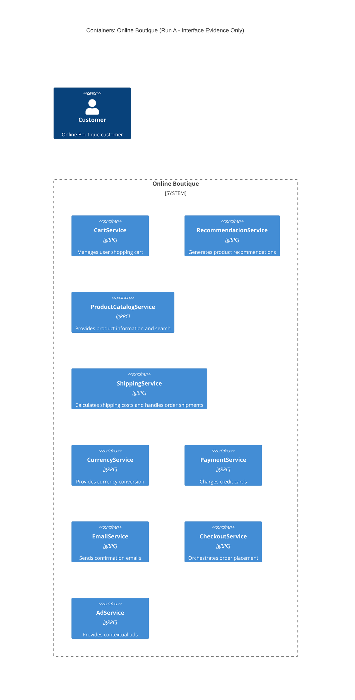

# Architecture Recovery - Run A

## 1. Agent
- **Product:** Antigravity (Gemini Code Assist / Gemini CLI compatible)
- **Model:** Gemini 3.8 Flash

## 2. Files read
- `system/online-boutique/protos/demo.proto`

## 3. Containers table

| Name | Technology / Language | Responsibility | Evidence |
|---|---|---|---|
| CartService | gRPC (Implementation language: Not evidenced in the provided files) | Manages user shopping cart items (`AddItem`, `GetCart`, `EmptyCart`) | `system/online-boutique/protos/demo.proto` (lines 23–27) |
| RecommendationService | gRPC (Implementation language: Not evidenced in the provided files) | Generates recommended product IDs for users (`ListRecommendations`) | `system/online-boutique/protos/demo.proto` (lines 56–58) |
| ProductCatalogService | gRPC (Implementation language: Not evidenced in the provided files) | Provides product listing, details, and search capabilities (`ListProducts`, `GetProduct`, `SearchProducts`) | `system/online-boutique/protos/demo.proto` (lines 71–75) |
| ShippingService | gRPC (Implementation language: Not evidenced in the provided files) | Provides shipping price quotes and ships orders (`GetQuote`, `ShipOrder`) | `system/online-boutique/protos/demo.proto` (lines 107–110) |
| CurrencyService | gRPC (Implementation language: Not evidenced in the provided files) | Handles currency conversion and returns supported currencies (`GetSupportedCurrencies`, `Convert`) | `system/online-boutique/protos/demo.proto` (lines 140–143) |
| PaymentService | gRPC (Implementation language: Not evidenced in the provided files) | Authorizes and charges credit card transactions (`Charge`) | `system/online-boutique/protos/demo.proto` (lines 177–179) |
| EmailService | gRPC (Implementation language: Not evidenced in the provided files) | Sends order confirmation emails (`SendOrderConfirmation`) | `system/online-boutique/protos/demo.proto` (lines 199–201) |
| CheckoutService | gRPC (Implementation language: Not evidenced in the provided files) | Orchestrates checkout and order placement (`PlaceOrder`) | `system/online-boutique/protos/demo.proto` (lines 224–226) |
| AdService | gRPC (Implementation language: Not evidenced in the provided files) | Serves advertisements based on contextual keywords (`GetAds`) | `system/online-boutique/protos/demo.proto` (lines 243–245) |

## 4. Dependencies table

| Caller → Callee | Protocol | Evidence |
|---|---|---|
| *(None evidenced in the provided files)* | Not evidenced | Protobuf service definitions define interfaces only, not call relationships. |

## 5. Mermaid diagram

## 6. Gaps

1. **Caller → Callee Dependencies:**
   - `demo.proto` specifies the gRPC interfaces, request/response message schemas, and RPC endpoints, but contains no invocation or call graph information showing which container calls which.
   - *Files needed:* Service implementation source codes (e.g., `src/*/...`) or deployment configuration manifests defining endpoint environment variables (e.g., `kubernetes-manifests/`).

2. **Frontend / Web UI / Ingress Container:**
   - There is no frontend container or HTTP/Web client defined in `demo.proto`. It is unknown how an end-user (`Person`) interacts with these services.
   - *Files needed:* Deployment configurations or source code for web/frontend services (e.g., `kubernetes-manifests/frontend.yaml` or `src/frontend/`).

3. **Data Stores (Databases / Caches / State Storage):**
   - No databases (e.g., Redis, SQL) or storage persistence engines are declared in `demo.proto`. It is unknown where cart items, product catalogs, or user data are stored.
   - *Files needed:* Deployment manifests or backend service implementations.

4. **Implementation Languages and Technologies:**
   - Only `proto3` and Go package naming option (`option go_package = "...";`) are stated in `demo.proto`. The actual runtime technology and programming languages for each individual service cannot be determined.
   - *Files needed:* Source directories or `Dockerfile`s for each service.
