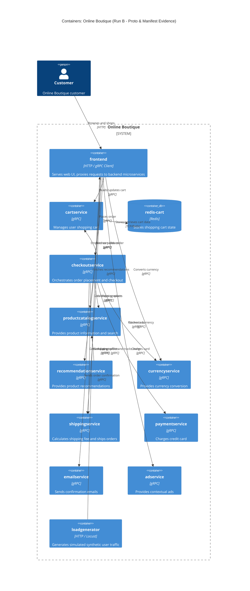

# Architecture Recovery - Run B

## 1. Agent
- **Product:** Antigravity (Gemini Code Assist / Gemini CLI compatible)
- **Model:** Gemini 3.8 Flash

## 2. Files read
- `system/online-boutique/protos/demo.proto`
- `system/online-boutique/kubernetes-manifests/kustomization.yaml`
- `system/online-boutique/kubernetes-manifests/adservice.yaml`
- `system/online-boutique/kubernetes-manifests/cartservice.yaml`
- `system/online-boutique/kubernetes-manifests/checkoutservice.yaml`
- `system/online-boutique/kubernetes-manifests/currencyservice.yaml`
- `system/online-boutique/kubernetes-manifests/emailservice.yaml`
- `system/online-boutique/kubernetes-manifests/frontend.yaml`
- `system/online-boutique/kubernetes-manifests/loadgenerator.yaml`
- `system/online-boutique/kubernetes-manifests/paymentservice.yaml`
- `system/online-boutique/kubernetes-manifests/productcatalogservice.yaml`
- `system/online-boutique/kubernetes-manifests/recommendationservice.yaml`
- `system/online-boutique/kubernetes-manifests/shippingservice.yaml`

## 3. Containers table

| Name | Technology / Language | Responsibility | Evidence |
|---|---|---|---|
| frontend | HTTP Server / gRPC Client (Port 8080) | Serves web UI for users, coordinates requests across backend services | `system/online-boutique/kubernetes-manifests/frontend.yaml` (lines 38–137) |
| cartservice | gRPC (Port 7070) | Stores and manages items in user carts | `system/online-boutique/kubernetes-manifests/cartservice.yaml` (lines 37–83), `system/online-boutique/protos/demo.proto` (lines 23–27) |
| redis-cart | Redis (`redis:alpine`, Port 6379) | In-memory key-value data store for user cart storage | `system/online-boutique/kubernetes-manifests/cartservice.yaml` (lines 89–156) |
| checkoutservice | gRPC (Port 5050) | Orchestrates end-to-end checkout, payment, shipping, and notification | `system/online-boutique/kubernetes-manifests/checkoutservice.yaml` (lines 37–91), `system/online-boutique/protos/demo.proto` (lines 224–226) |
| productcatalogservice | gRPC (Port 3550) | Provides list, search, and details of products | `system/online-boutique/kubernetes-manifests/productcatalogservice.yaml` (lines 37–82), `system/online-boutique/protos/demo.proto` (lines 71–75) |
| currencyservice | gRPC (Port 7000) | Handles currency conversion and returns supported currencies | `system/online-boutique/kubernetes-manifests/currencyservice.yaml` (lines 37–83), `system/online-boutique/protos/demo.proto` (lines 140–143) |
| recommendationservice | gRPC (Port 8080) | Recommends products based on user context | `system/online-boutique/kubernetes-manifests/recommendationservice.yaml` (lines 37–86), `system/online-boutique/protos/demo.proto` (lines 56–58) |
| shippingservice | gRPC (Port 50051) | Calculates shipping costs and provides order tracking ID | `system/online-boutique/kubernetes-manifests/shippingservice.yaml` (lines 37–82), `system/online-boutique/protos/demo.proto` (lines 107–110) |
| paymentservice | gRPC (Port 50051) | Charges credit cards | `system/online-boutique/kubernetes-manifests/paymentservice.yaml` (lines 37–82), `system/online-boutique/protos/demo.proto` (lines 177–179) |
| emailservice | gRPC (Port 8080 internal / 5000 service) | Sends order confirmation emails | `system/online-boutique/kubernetes-manifests/emailservice.yaml` (lines 37–84), `system/online-boutique/protos/demo.proto` (lines 199–201) |
| adservice | gRPC (Port 9555) | Provides contextual advertisement text | `system/online-boutique/kubernetes-manifests/adservice.yaml` (lines 37–84), `system/online-boutique/protos/demo.proto` (lines 243–245) |
| loadgenerator | HTTP client (`busybox`, `loadgenerator`) | Generates synthetic simulated user web traffic | `system/online-boutique/kubernetes-manifests/loadgenerator.yaml` (lines 37–95) |

## 4. Dependencies table

| Caller → Callee | Protocol | Evidence |
|---|---|---|
| Customer → frontend | HTTP | `system/online-boutique/kubernetes-manifests/frontend.yaml` (lines 123–137, Service `frontend-external`, port 80 → targetPort 8080) |
| loadgenerator → frontend | HTTP | `system/online-boutique/kubernetes-manifests/loadgenerator.yaml` (line 70 and 83, `FRONTEND_ADDR="frontend:80"`) |
| frontend → productcatalogservice | gRPC | `system/online-boutique/kubernetes-manifests/frontend.yaml` (lines 69–70, `PRODUCT_CATALOG_SERVICE_ADDR="productcatalogservice:3550"`) |
| frontend → currencyservice | gRPC | `system/online-boutique/kubernetes-manifests/frontend.yaml` (lines 71–72, `CURRENCY_SERVICE_ADDR="currencyservice:7000"`) |
| frontend → cartservice | gRPC | `system/online-boutique/kubernetes-manifests/frontend.yaml` (lines 73–74, `CART_SERVICE_ADDR="cartservice:7070"`) |
| frontend → recommendationservice | gRPC | `system/online-boutique/kubernetes-manifests/frontend.yaml` (lines 75–76, `RECOMMENDATION_SERVICE_ADDR="recommendationservice:8080"`) |
| frontend → shippingservice | gRPC | `system/online-boutique/kubernetes-manifests/frontend.yaml` (lines 77–78, `SHIPPING_SERVICE_ADDR="shippingservice:50051"`) |
| frontend → checkoutservice | gRPC | `system/online-boutique/kubernetes-manifests/frontend.yaml` (lines 79–80, `CHECKOUT_SERVICE_ADDR="checkoutservice:5050"`) |
| frontend → adservice | gRPC | `system/online-boutique/kubernetes-manifests/frontend.yaml` (lines 81–82, `AD_SERVICE_ADDR="adservice:9555"`) |
| cartservice → redis-cart | TCP / Redis | `system/online-boutique/kubernetes-manifests/cartservice.yaml` (lines 50–51, `REDIS_ADDR="redis-cart:6379"`) |
| recommendationservice → productcatalogservice | gRPC | `system/online-boutique/kubernetes-manifests/recommendationservice.yaml` (lines 60–61, `PRODUCT_CATALOG_SERVICE_ADDR="productcatalogservice:3550"`) |
| checkoutservice → productcatalogservice | gRPC | `system/online-boutique/kubernetes-manifests/checkoutservice.yaml` (lines 57–58, `PRODUCT_CATALOG_SERVICE_ADDR="productcatalogservice:3550"`) |
| checkoutservice → shippingservice | gRPC | `system/online-boutique/kubernetes-manifests/checkoutservice.yaml` (lines 59–60, `SHIPPING_SERVICE_ADDR="shippingservice:50051"`) |
| checkoutservice → paymentservice | gRPC | `system/online-boutique/kubernetes-manifests/checkoutservice.yaml` (lines 61–62, `PAYMENT_SERVICE_ADDR="paymentservice:50051"`) |
| checkoutservice → emailservice | gRPC | `system/online-boutique/kubernetes-manifests/checkoutservice.yaml` (lines 63–64, `EMAIL_SERVICE_ADDR="emailservice:5000"`) |
| checkoutservice → currencyservice | gRPC | `system/online-boutique/kubernetes-manifests/checkoutservice.yaml` (lines 65–66, `CURRENCY_SERVICE_ADDR="currencyservice:7000"`) |
| checkoutservice → cartservice | gRPC | `system/online-boutique/kubernetes-manifests/checkoutservice.yaml` (lines 67–68, `CART_SERVICE_ADDR="cartservice:7070"`) |

## 5. Mermaid diagram

## 6. Gaps

1. **Missing Manifest for `shoppingassistantservice`:**
   - In `system/online-boutique/kubernetes-manifests/frontend.yaml` (lines 83–84), `SHOPPING_ASSISTANT_SERVICE_ADDR="shoppingassistantservice:80"` is declared. However, no Kubernetes manifest or Service definition exists for `shoppingassistantservice` in `kubernetes-manifests/` (it is commented out in `kustomization.yaml` line 35). Thus it cannot be verified as an active container or dependency without additional manifests.
   - *Files needed:* `kustomize/components/shopping-assistant` or service deployment manifests.

2. **Programming Languages & Frameworks:**
   - Container images are listed simply as `frontend`, `cartservice`, `checkoutservice`, etc. The actual implementation languages (e.g. Go, C#, Python, Node.js, Java) are not stated in the Kubernetes manifests.
   - *Files needed:* Service source code directories (`src/*/`) or `Dockerfile`s.

3. **Product Catalog Storage:**
   - `productcatalogservice` does not have any attached database container or persistent volume in `productcatalogservice.yaml`. It is unknown whether product data is hardcoded/in-memory or stored externally.
   - *Files needed:* `src/productcatalogservice/` source files.

4. **External Payment / Email Providers:**
   - `paymentservice` and `emailservice` do not declare credentials or external endpoints for real payment gateways (e.g. Stripe) or SMTP servers in their manifests. It is unknown whether they call external systems or mock the responses.
   - *Files needed:* Source code for `paymentservice` and `emailservice`.
